# HoloGenesis

**From creative intent to computational experience.**

HoloGenesis is the creative engine of **HoloVision** — an evolving ecosystem connecting knowledge, imagination and
experience. It explores a new frontier of creative computation, where ideas and abstract relationships unfold into
geometry, light, sound, movement and interactive worlds. Conceived as a *transmodal bridge*, its deeper purpose is not
merely to translate between media, but to preserve the meaning of a vision as it takes on new forms.

At its core, a local AI-powered Studio transforms creative briefs into executable artifacts that can be inspected,
experienced live, refined and exported. Some works can be developed entirely within HoloGenesis; others can be prepared
for continuation in professional creative environments. The broader vision is a **bidirectional creative continuum**
spanning tools such as ComfyUI, Blender, TouchDesigner, Ableton Live and Unreal Engine — allowing works to evolve across
media and return to HoloGenesis for audiovisual integration, evaluation and further refinement. **A continuous creative
process in which each medium becomes another expression of the same underlying vision.**

The eleven works in this repository are programs, not pictures. Each one is the code that the AI model wrote through the
Studio's workflow, published exactly as the Studio saved it, and every image and animation of it was rendered from that
code. Most of them are mathematics made visible: a honeycomb of hyperbolic space, a fractal that lives in four
dimensions, the limit set of a Kleinian group, reaction–diffusion, a tiling that never repeats, the modes of a drum.

<p align="center">
  <a href="docs/media/studio-hero.png"></a>
</p>
<p align="center"><em>The Studio: sessions, a live preview of Impossible Cubes, and the inspector.</em></p>

<p align="center">
  <a href="#what-it-is">What it is</a> ·
  <a href="#how-it-works">How it works</a> ·
  <a href="#gallery">Gallery</a> ·
  <a href="#art-and-code">Art and code</a> ·
  <a href="#the-studio">The Studio</a> ·
  <a href="#capabilities">Capabilities</a> ·
  <a href="#verification-and-provenance">Verification</a> ·
  <a href="#repository-layout">Repository layout</a>
</p>

## What it is

HoloGenesis sits where art direction meets programming. Artists and designers think in images, moods and rules, while
computers need precise code. HoloGenesis is an independent creative-technology project built to bridge that gap. It
uses AI and creative coding as instruments for artistic expression, not as a black box.

Three ideas guide it:

- **Visible by design.** Every stage of a run is shown as it happens, and every result is plain code, open to inspection
  and download.
- **Checked, not just generated.** HoloGenesis checks that a result fits a supported runtime before running it in an
  isolated view, and the Studio reports what is actually running. Mathematical pieces are compared with independent
  reference calculations.
- **Local by design.** The Studio and its sessions live on the local machine. Only the requests to the AI services it
  is set up to use leave it.

For every work here, the path from brief to running piece is on record: the fingerprint of the brief, the model and
its settings, every run, and how the result was checked. This repository is a showcase. It holds this README, authentic
screenshots of the Studio, eleven works that HoloGenesis generated, and seven demonstration studies written outside it.
The engine itself is developed privately. Only a few sanitized, self-contained parts of its source are published
here, in `engine-excerpts/`; their commits keep the original development dates.

## How it works

HoloGenesis is a system that turns a brief into an executable computational artifact, such as a shader, a 3D scene
or a living simulation, and then runs it. Every request passes through one
workflow of named stages, and the Studio shows each stage as it runs. The workflow can take two routes.

### Single Agent: one model call, from brief to running work

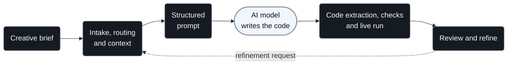

Read it from left to right. A creative brief is checked and routed, the context it needs is assembled, and HoloGenesis writes
a structured prompt. The AI model is called once, at the light, rounded step, and returns code. HoloGenesis extracts
that code, checks that it fits a supported runtime, saves it and runs it live in an isolated preview, making the
result immediately visible. A refinement request sends the work through the same path again with its new instruction,
and the new result joins the session, which retains its newest twelve results. This matters because the model only writes
the code: HoloGenesis handles the checks and live preview, keeping retained results traceable, runnable and ready for
refinement. **All eleven works in this repository were generated on this route by
OpenAI's `gpt-6-sol` model: one model call per run, no automatic retry, and every refinement a separate, recorded
run.**

### Multi Agent: several roles in one workflow

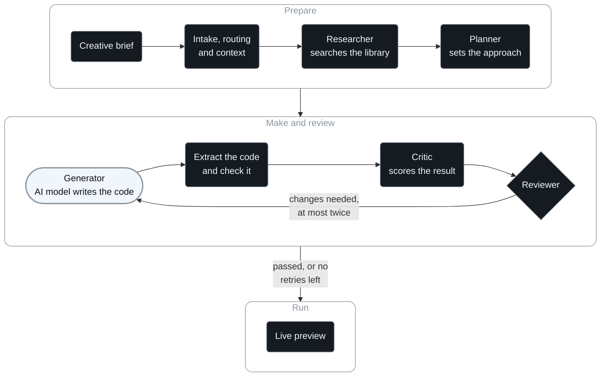

Here the same workflow is shared among five roles, in three phases. To prepare, a researcher searches a local,
curated library of official documentation, and a planner settles the approach and the creative direction before any
code is written. Then the generator, the only role that calls the AI model, writes the code; the critic scores it for
fit with the brief, the runtime, code quality and preview readiness; and the reviewer either passes it or adds its
notes to the prompt and sends it back to the generator, at most twice. A run therefore makes one to three model calls,
its latest version runs live in the preview, and the Studio shows how many retry loops it took. This matters because
quality control is part of the workflow, and it is transparent: the planner, the critic and the reviewer follow
explicit rules that HoloGenesis itself applies, so every decision can be inspected in the Studio. *Auto*, the Studio's
default, chooses this route for creative briefs, and the Single Agent route for quick explanations and debugging.

In both routes, if a brief is too ambiguous, the first stages send a question back before the prompt is written, so no
model call is spent on a guess.

<p align="center">
  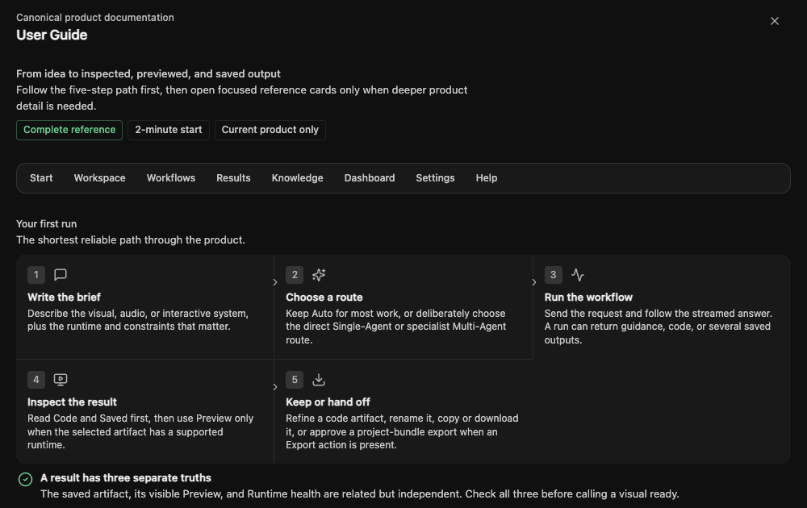
  <br><sub><b>The User Guide.</b> Five steps from creative brief to saved result.</sub>
</p>

## Gallery

Every piece below runs in the Studio's own live preview. The eleven works were generated by HoloGenesis itself: a brief
went into the Studio, the workflow above called the model, and the code that came back is published exactly as the
Studio saved it. Nobody edited it by hand. They cover five families: fractals, non-Euclidean geometry, morphogenesis,
cymatics and aperiodic order. The studies after them were written elsewhere, and the Studio only runs them.

### Impossible Cubes

*Generated by HoloGenesis. Runtime: GLSL fragment shader (WebGL 1).*

<p align="center">
  <a href="docs/media/impossible-cubes.mp4">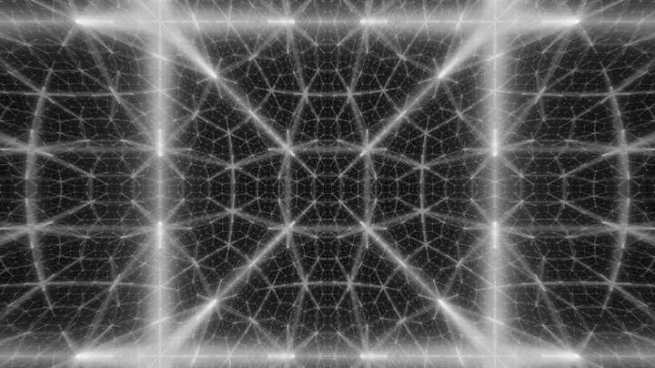</a>
  <br><sub>Flight through hyperbolic space · <a href="docs/media/impossible-cubes.mp4">MP4</a></sub>
</p>

A flight through hyperbolic space, filled with cubes so that **five** of them meet around every edge. In ordinary space
only four fit. The cubes' edges glow as silver beams, curve away in every direction and shrink towards a horizon that
lies infinitely far away. The full 24-second loop is shown at twice its speed, rendered offline from the unchanged source at
4 × 4 samples per pixel.

- **Exact geometry.** Every beam follows from the symmetry group of the honeycomb {4,3,5}: four mirrors, reflected
  again and again, fill the whole space. Each ray of light is traced as a billiard ball bouncing between those mirrors.
- **Checked independently.** The mirrors, the corners of the cell and the length of the seamless camera loop were
  recomputed from the shader's own constants, and every value agrees. [The geometry](docs/impossible-cubes-geometry.md)
  explains the construction and the checks.
- **Known limit.** The shader takes one ray per pixel, so the most distant edges twinkle in motion.

Source: [`works/impossible-cubes-435.frag`](works/impossible-cubes-435.frag).

### Quaternion Julia

*Generated by HoloGenesis. Runtime: GLSL fragment shader (WebGL 1).*

<p align="center">
  <a href="docs/media/quaternion-julia.mp4">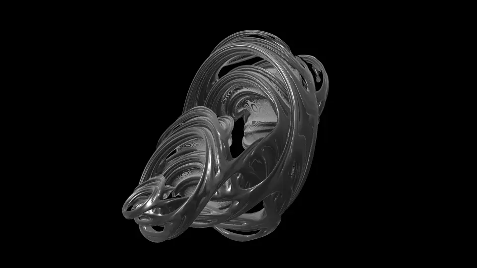</a>
  <br><sub>Quaternion Julia in motion · <a href="docs/media/quaternion-julia.mp4">MP4</a></sub>
</p>

A three-dimensional slice through a Julia set that lives in four dimensions: every point is a quaternion, iterated as
*q*² + *c*. As *c* drifts on an 80-second loop, ribbons of liquid silver fold, part and rejoin, while the camera circles
the form. The animation shows 20 seconds from 27 to 47 seconds at twice its speed, rendered offline from unchanged
source at 4 × 4 samples per pixel.

- **First version.** Published as the first run produced it. A later refinement in the same session, which smoothed
  the stripes described below, is not the version shown here.
- **Known limit.** In the Studio's live preview, with one sample per pixel, fine moiré stripes and contour bands show in
  the hollows. The animation above averages 16 samples per pixel; faint bands remain in the deepest hollows.

Source: [`works/quaternion-julia.frag`](works/quaternion-julia.frag).

### Silver Mandelbulb

*Generated by HoloGenesis. Runtime: GLSL fragment shader (WebGL 1).*

<p align="center">
  <a href="docs/media/silver-mandelbulb.mp4">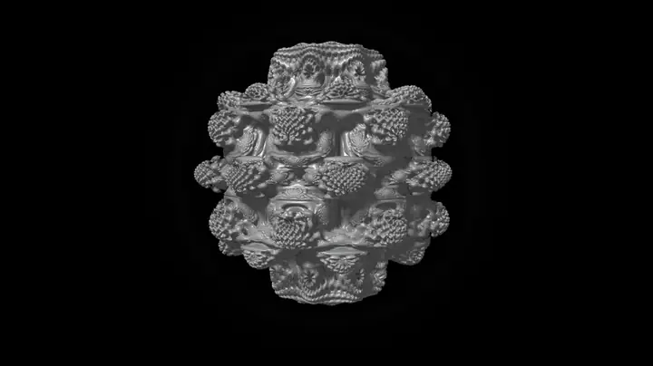</a>
  <br><sub>Silver Mandelbulb in motion · <a href="docs/media/silver-mandelbulb.mp4">MP4</a></sub>
</p>

The best-known three-dimensional fractal, raymarched by its distance estimate, with soft shadows and occlusion. The
camera circles it while its power breathes between 7 and 9. The animation shows 15 seconds from 10 seconds in at real
speed, rendered offline from the unchanged source at 2 × 2 samples per pixel.

- **Refined four times.** The first version had rich detail, but the form overflowed the frame and its silver read
  as dark graphite. Four refinement requests, each a separate run, framed the whole form, turned the key light towards
  it, lowered the exposure so that nothing clipped, and finally brightened the metal and widened its highlights.

<p align="center">
  <a href="docs/media/studio-mandelbulb-generation.png">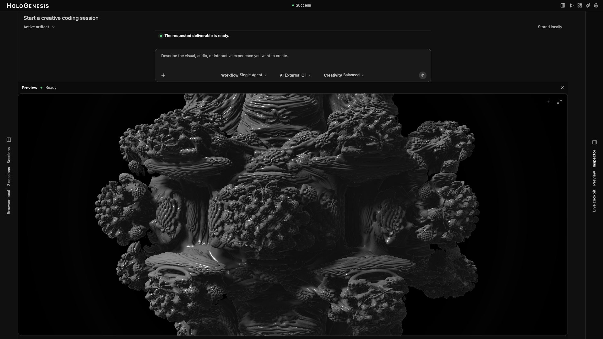</a>
  <br><sub>First Silver Mandelbulb: detailed, oversized and dark; collapsed sidebars maximize the in-app preview.</sub>
</p>

Source: [`works/silver-mandelbulb.frag`](works/silver-mandelbulb.frag).

### Silver Morphogenesis

*Generated by HoloGenesis. Runtime: Three.js.*

<p align="center">
  <a href="docs/media/silver-morphogenesis.mp4">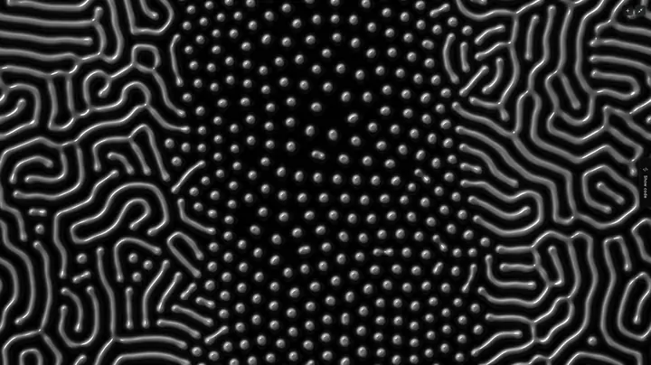</a>
  <br><sub>Live reaction–diffusion simulation · <a href="docs/media/silver-morphogenesis.mp4">MP4</a></sub>
</p>

Two chemicals react and spread across the whole frame, a Gray–Scott system computed live on the graphics card. Feed and
kill rates change slowly from place to place, so cells divide in one region, worms branch into networks in another,
and labyrinths fold elsewhere. The landscape drifts, so the regions keep turning into one another, and it never
settles. The 15-second animation was captured from the Studio's fullscreen preview. The second chemical is lit as a height field: ridges catch a silver highlight and valleys fall to black.

- **Refined once.** The first version had fine forms and a seam at one edge of the frame. One refinement request made
  the forms larger, wrapped the simulation around so no edge can show a seam, and strengthened the relief.

Source: [`works/silver-morphogenesis.three.js`](works/silver-morphogenesis.three.js).

### More works

*Generated by HoloGenesis, and shown in the Studio's fullscreen preview.*

<table>
  <tr>
    <td width="50%" valign="top">
      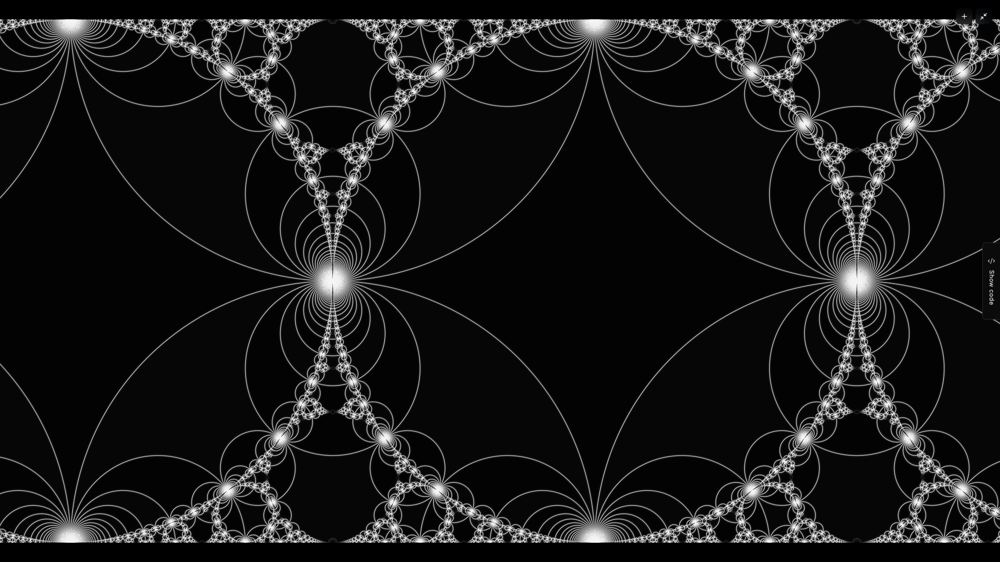
      <br><b>Indra's Pearls</b> · GLSL<br><sub>Kleinian circles, traced by Jos Leys' method · <a href="docs/media/indras-pearls.mp4">MP4</a> · <a href="works/indras-pearls.frag">Source</a></sub>
    </td>
    <td width="50%" valign="top">
      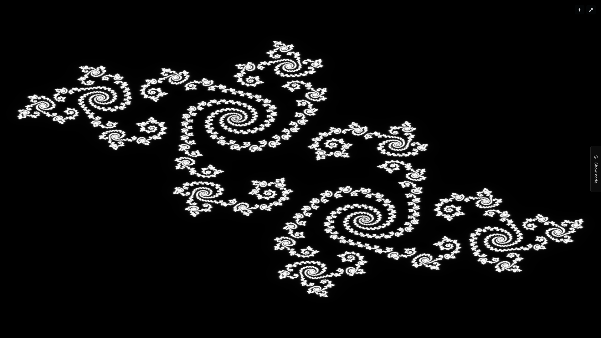
      <br><b>Silver Julia Filaments</b> · GLSL<br><sub>Julia filaments placed by the exterior distance estimate · <a href="works/silver-julia-filaments.frag">Source</a></sub>
    </td>
  </tr>
  <tr>
    <td width="50%" valign="top">
      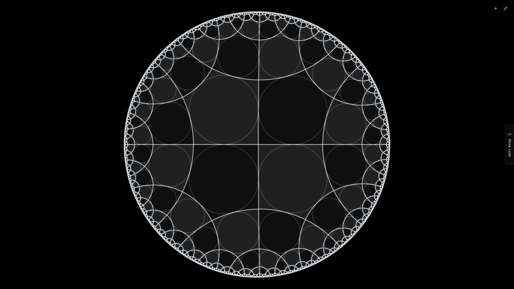
      <br><b>Circle Limit: Pentagons</b> · GLSL<br><sub>A seamless hyperbolic tiling · <a href="works/circle-limit-pentagons.frag">Source</a></sub>
    </td>
    <td width="50%" valign="top">
      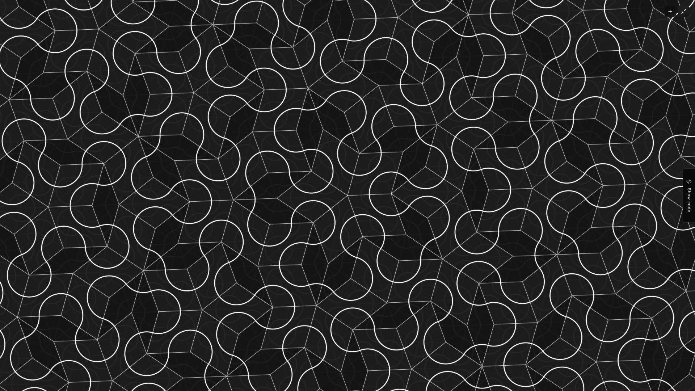
      <br><b>Penrose Infinite</b> · GLSL<br><sub>A self-similar Penrose tiling · <a href="works/penrose-infinite.frag">Source</a></sub>
    </td>
  </tr>
  <tr>
    <td width="50%" valign="top">
      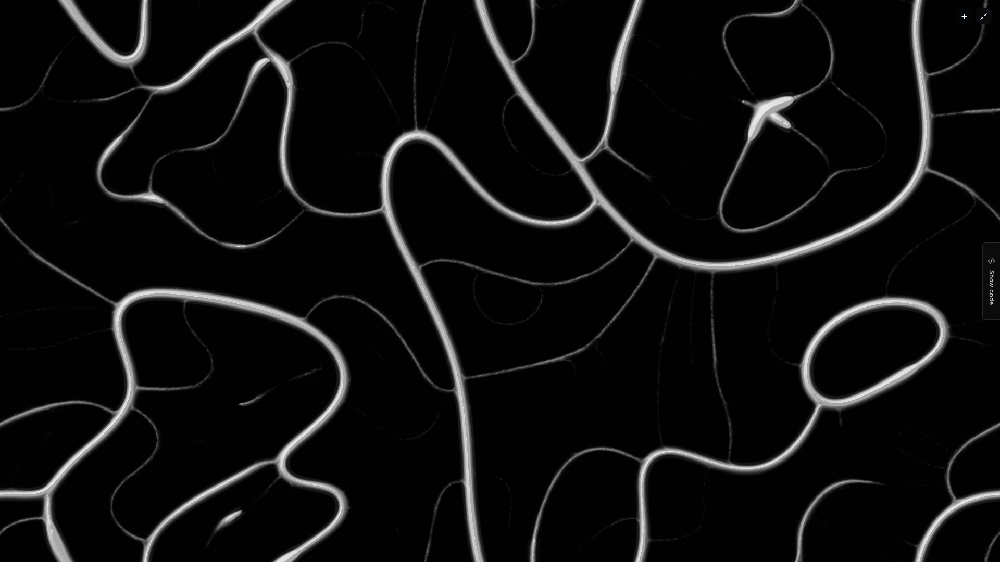
      <br><b>Silver Physarum</b> · Three.js<br><sub>A living network of slime-mould agents · <a href="docs/media/silver-physarum.mp4">MP4</a> · <a href="works/silver-physarum.three.js">Source</a></sub>
    </td>
    <td width="50%" valign="top">
      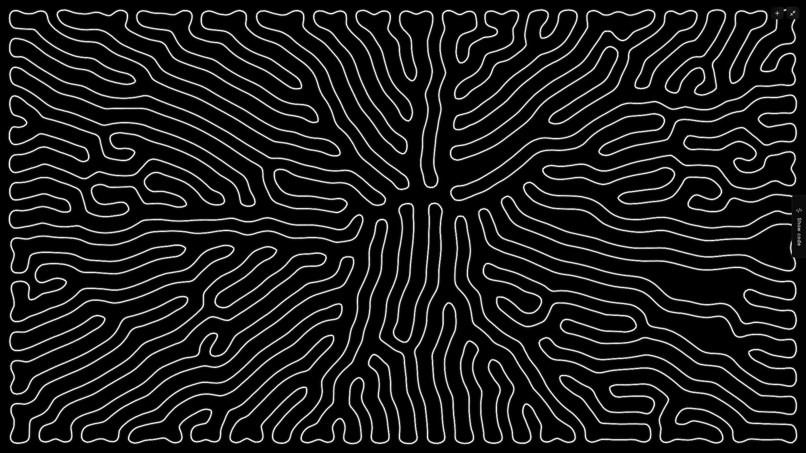
      <br><b>Silver Meander</b> · Three.js<br><sub>Differential growth forms a silver labyrinth · <a href="works/silver-meander.three.js">Source</a></sub>
    </td>
  </tr>
</table>

*Indra's Pearls* follows the book *Indra's Pearls* by Mumford, Series and Wright, tracing each pixel with Jos Leys'
method for Maskit's slice; it loops without a seam every 40 seconds. *Circle Limit: Pentagons* is after M. C. Escher's
*Circle Limit* prints. *Silver Physarum* was refined twice; *Circle Limit: Pentagons*, *Penrose Infinite* and *Silver
Meander* were refined once. The MP4 of *Indra's Pearls* is an offline render of the unchanged source; that of *Silver
Physarum* shows 15 seconds in the Studio's fullscreen preview.

The eleventh work, *Seven Notes on a Drumhead*, is cymatics computed from physics: each pixel sums the modes of a
circular drum, and the Studio's own frames were checked note by note against an independent calculation. Its code and
[the model](docs/seven-notes-model.md) are in the repository: [`works/seven-notes-on-a-drumhead.frag`](works/seven-notes-on-a-drumhead.frag).

Provenance for all eleven works is in [`works/README.md`](works/README.md): the briefs' fingerprints, the model and
settings, every run and how each result was checked.

### External studies

*Written outside HoloGenesis and run by the Studio's fullscreen preview.* All seven studies, with their mathematics,
are listed in [`studies/README.md`](studies/README.md).

<p align="center">
  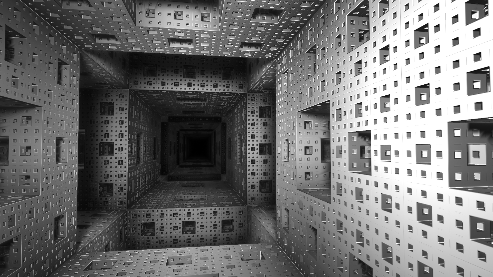
  <br><sub><b>Shader.</b> A recursive Menger-sponge cathedral.</sub>
</p>

<table>
  <tr>
    <td width="50%" valign="top">
      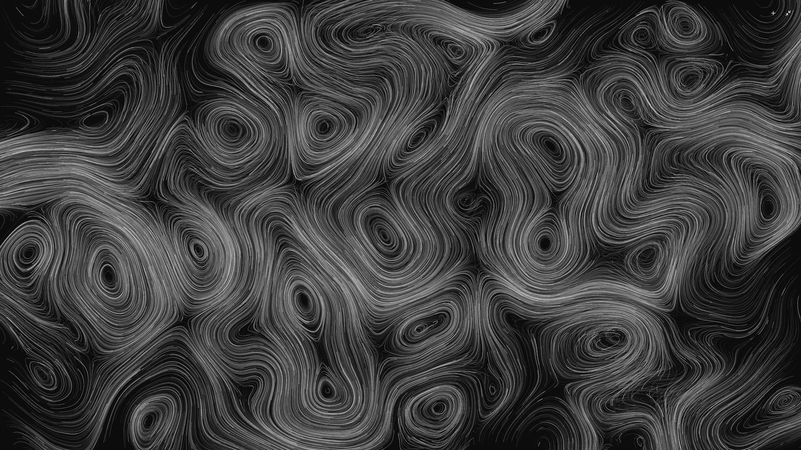
      <br><sub><b>p5.js.</b> Curl-noise particles trace silver streamlines.</sub>
    </td>
    <td width="50%" valign="top">
      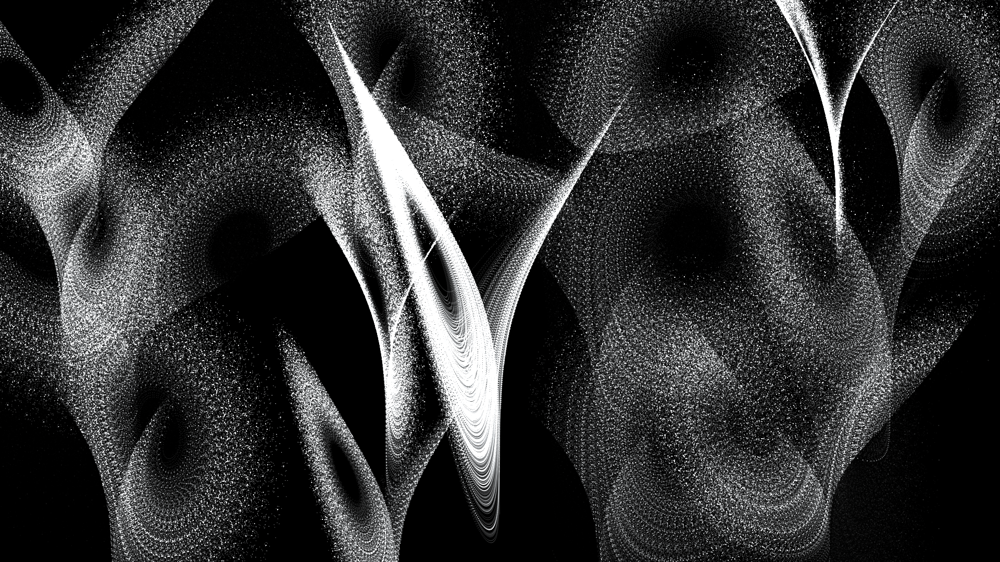
      <br><sub><b>Three.js.</b> Lorenz attractors traced in luminous points.</sub>
    </td>
  </tr>
</table>

## Art and code

<p align="center">
  <a href="docs/media/studio-fullscreen-code.mp4">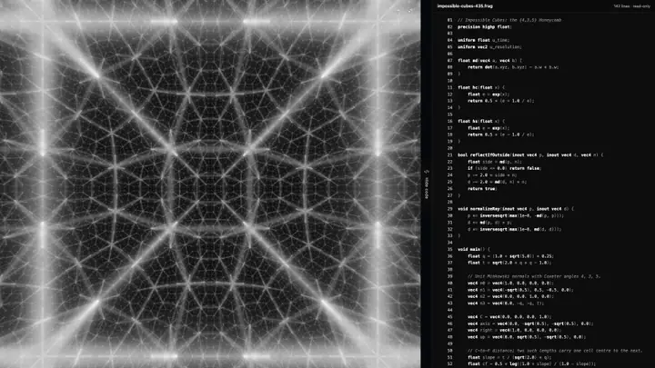</a>
  <br><sub>Fullscreen Art and code: live preview with source · <a href="docs/media/studio-fullscreen-code.mp4">MP4</a> · <a href="docs/media/studio-fullscreen-code.png">Full-size still</a></sub>
</p>

In fullscreen, the Studio can open the running piece's source beside it, read-only, while the artwork keeps playing.
The animation shows the full 24-second loop at twice its speed; at one sample per pixel, the most distant edges twinkle.
The full-size still shows the source beside the artwork. The lines below are quoted from that source.

The cubes' code reads like its geometry. The whole honeycomb comes from four mirrors, and the four mirrors are four
vectors:

```glsl
    // Unit Minkowski normals with Coxeter angles 4, 3, 5.
    vec4 n0 = vec4(1.0, 0.0, 0.0, 0.0);
    vec4 n1 = vec4(-sqrt(0.5), 0.5, -0.5, 0.0);
    vec4 n2 = vec4(0.0, 0.0, 1.0, 0.0);
    vec4 n3 = vec4(0.0, -q, -q, t);
```

Here `q` is cos 36°. The angle of 36°, a fifth of a half-turn, is where the five cubes around every edge come from.

Each ray is a billiard ball. Whenever a step carries it across a mirror, the point and its direction are reflected
back:

```glsl
bool reflectIfOutside(inout vec4 p, inout vec4 d, vec4 n) {
    float side = md(p, n);
    if (side <= 0.0) return false;
    p -= 2.0 * side * n;
    d -= 2.0 * md(d, n) * n;
    return true;
}
```

`md` is the Minkowski product of hyperbolic space. Measured with it, a reflection is the same one-line formula as in
ordinary space.

## The Studio

The Studio looks and feels like a modern code editor, in a calm dark theme: sessions on the left, the conversation
and the live preview in the middle, and on the right an inspector that explains the run, as in the screenshot at the
top of this page. Each session is saved on the local machine with its newest twelve works.

### The inspector

The inspector on the right has tabs for details about a run. Four of them, for *Indra's Pearls*
in the same session (images link to full-size views):

<table>
  <tr>
    <td width="50%" valign="top">
      <a href="docs/media/panel-preview.png">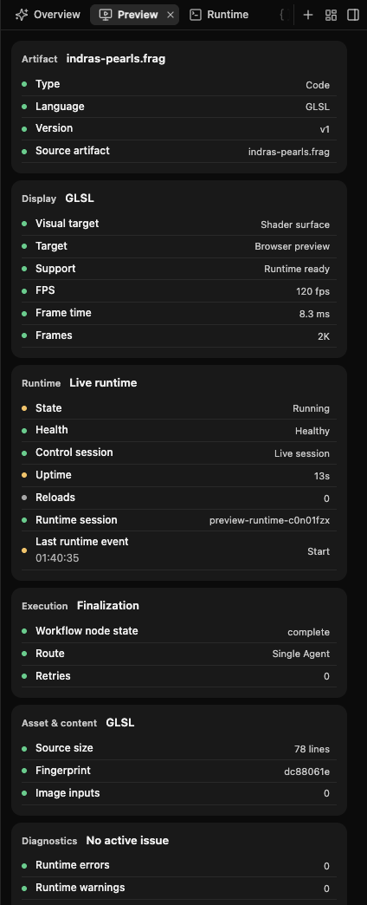</a>
      <br><sub><b>Preview.</b> Renderer, performance, route and errors.</sub>
    </td>
    <td width="50%" valign="top">
      <a href="docs/media/panel-code.png">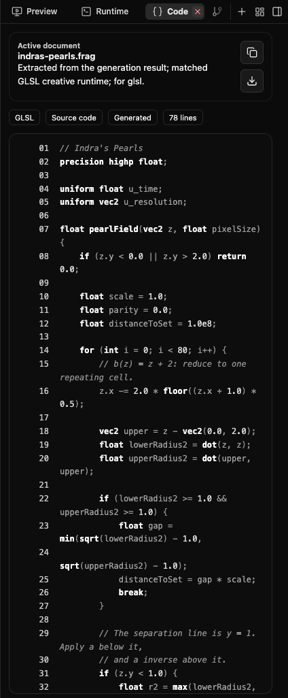</a>
      <br><sub><b>Code.</b> Generated source and export.</sub>
    </td>
  </tr>
  <tr>
    <td width="50%" valign="top">
      <a href="docs/media/panel-runtime.png"></a>
      <br><sub><b>Runtime.</b> Live execution and diagnostics.</sub>
    </td>
    <td width="50%" valign="top">
      <a href="docs/media/panel-artifacts.png">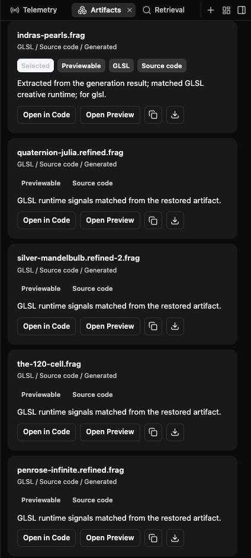</a>
      <br><sub><b>Artifacts.</b> Saved works and versions.</sub>
    </td>
  </tr>
</table>

A saved session keeps its newest twelve results, failed attempts included; this one holds twelve generations and
refinements, of which the Artifacts tab shows the newest five. Any of them can be previewed, inspected, refined or
downloaded again.

### Dashboard settings

<p align="center">
  <a href="docs/media/studio-dashboard-settings.png">
    </a>
  <br><sub>Dashboard settings — themes, code colouring and typography per session.</sub>
</p>

The dashboard's Appearance page sets each session's interface theme, code colouring and typography; changes apply at
once and leave the works untouched. In the workspace itself, User Mode keeps the view quiet, with the preview, the code
and the saved works close at hand; Developer Mode adds the views that explain a run, such as the workflow, the runtime
and its telemetry. A layout menu places either the conversation or the inspector in the centre, and the preview below
or above it.

### The dashboard

Beyond the workspace, a dashboard gives each part of the product its own reference page, from the workflow and the
runtime to the sessions, the evaluations and the User Guide shown earlier. Its artifact registry lists every saved
work. Where a supported runtime can draw a work, its card carries a live thumbnail; where none can, the card states
where the work has to go instead.

<p align="center">
  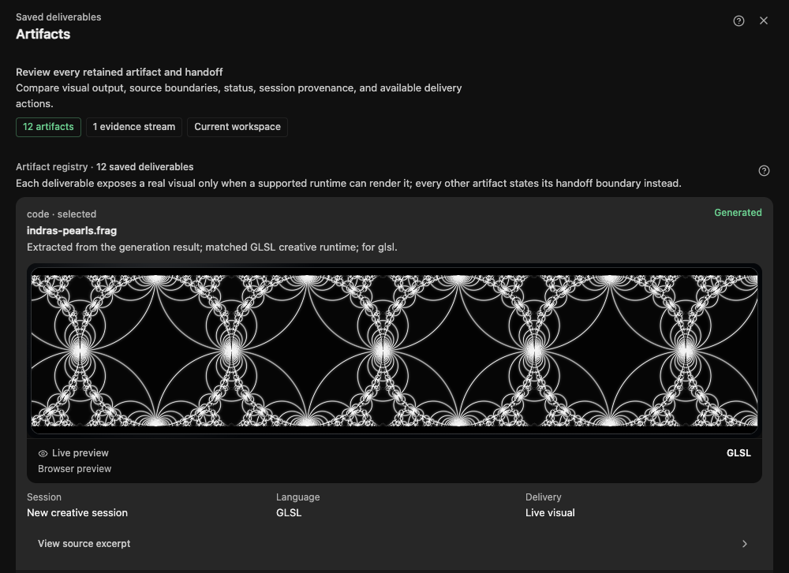
  <br><sub><b>The artifact registry.</b> Saved works, thumbnails, sessions and delivery.</sub>
</p>

## Capabilities

| What | How it helps | Limits |
| --- | --- | --- |
| Live preview | Runs GLSL shaders, Three.js 3D scenes, p5.js sketches and Tone.js sound in an isolated browser view, in a panel or fullscreen | p5.js sketches run in a compatible subset of p5; shaders must stay within 6,000 characters; sound starts on request |
| One workflow, two routes | A Single Agent route with one model call, or a Multi Agent route with planning, critique, review and up to two refinement loops | The planner, critic and reviewer follow explicit rules; only the generator writes code |
| Code beside the art | In fullscreen, a read-only panel shows the running piece's source, with syntax colouring and line numbers, while it keeps playing | Read-only: edits go through a refinement request |
| Several works per session | A session keeps its results; any of them can be previewed, inspected, refined or downloaded again | A saved session keeps its newest twelve works |
| Code and export | Open, copy, download, refine and save any result | Some formats, such as Hydra or React Three Fiber, arrive as code to use elsewhere, without a live preview |
| External tools | Prepares source and supporting files for TouchDesigner, Blender, Houdini, Unreal and Unity | HoloGenesis hands the work over; it does not run those tools |
| Documentation library | Answers can draw on a local, versioned library of approved official documentation | No open-web browsing while answering |
| Sessions | Saved on the local machine, as workspace snapshots | Built for one person on one computer; no hosted service, shared accounts or public deployment |
| Transparency | Every stage of a run, the live runtime and the session's usage are reported as they happen | Usage is shown only when the AI service reports it; a reopened session does not keep the run's timing |
| AI generation | The model sits behind a provider layer and can be swapped: the OpenAI API by default, or an external command-line provider. The works here were generated by OpenAI's `gpt-6-sol` | No offline model is included; audio is not accepted as input; generated code can still fail or behave differently elsewhere; evaluations so far use small samples |

## Verification and provenance

HoloGenesis is tested in layers, from small units of logic up to automated browser checks of the Studio itself.

Every piece in this repository carries one of two labels:

- **Generated by HoloGenesis.** A model called by the Studio's own workflow wrote the code. The record of the run (the
  prompt the Studio sent, the model's own log and the code the Studio stored) agrees from end to end. See
  [`works/README.md`](works/README.md).
- **External study.** The code was written elsewhere, and the Studio only runs it. See
  [`studies/README.md`](studies/README.md).

Mathematical pieces are compared with independent calculations:

- *Seven Notes on a Drumhead* is checked note by note against a separate implementation of the same physics.
- *Impossible Cubes* has its whole construction recomputed from the shader's constants.
- The seamless loops of *Indra's Pearls* and *Circle Limit: Pentagons* were checked frame by frame: a frame and the frame
  one loop later are identical.

## Repository layout

```text
.
├── README.md                          this page
├── docs/
│   ├── impossible-cubes-geometry.md   the {4,3,5} construction and how it was checked
│   ├── seven-notes-model.md           the drumhead's physics, constants and checks
│   └── media/                         the screenshots, stills and animations shown here
├── engine-excerpts/                   sanitized, self-contained parts of the engine's source
│   ├── python/                        text, rendering and hashing helpers, with tests
│   └── studio/                        interface utilities, design tokens and shader examples
├── works/                             code generated by HoloGenesis, as the Studio saved it
│   ├── README.md                      provenance: brief fingerprints, model, settings, checks
│   ├── impossible-cubes-435.frag
│   ├── quaternion-julia.frag
│   ├── silver-mandelbulb.frag
│   ├── silver-morphogenesis.three.js
│   ├── seven-notes-on-a-drumhead.frag
│   ├── indras-pearls.frag
│   ├── silver-julia-filaments.frag
│   ├── circle-limit-pentagons.frag
│   ├── penrose-infinite.frag
│   ├── silver-physarum.three.js
│   └── silver-meander.three.js
└── studies/                           demonstration studies written outside HoloGenesis
    ├── README.md
    └── mono-*.frag, mono-*.three.js, mono-flow-field.p5.js
```

Apart from these excerpts, the engine's source is not part of this repository.
